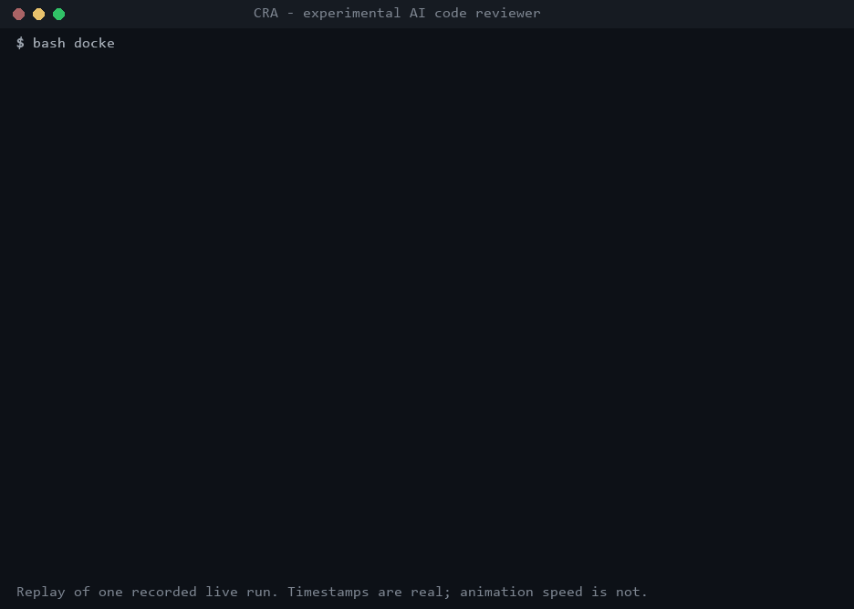

# CRA: an experimental AI code reviewer

CRA reviews the diff between two commits of a Git repository. One LLM investigates the code with four **read-only** tools, writes
its findings as structured JSON, and every finding is **checked against the real source** before it is reported.

> **Status: experimental.** It works on small, simple cases (below). It has **not** been shown to find complex or cross-file
> bugs, and it is not production-ready. See [Limitations](#limitations).



*A replay of one real run (`openai/gpt-oss-120b`, 6.6 s). The timestamps are real; the animation speed is not. Tool arguments are
shown without their default `offset`/`limit`. The data behind it is in [`docs/assets/cra-demo-evidence.json`](docs/assets/cra-demo-evidence.json).*

## How it works

```
 your Git repo ──► prep container ──► sanitised, read-only snapshot + diff
                                              │
   Groq API ◄── credential proxy ◄── agent container (no key, no internet)
   (holds the key,                      │
    caps requests)                      ├─ 1. investigate: model ⇄ 4 read-only tools (bounded loop)
                                        ├─ 2. write findings: one more model call, no tools, strict JSON schema
                                        └─ 3. verify: file, line and quoted code must exist in the snapshot
                                                  ▼
                                         lean-findings.json + lean-trace.jsonl
```

- **One reviewer, one loop.** The loop has a turn limit, a request-size budget (older tool results shrink to short references), a hard
  deadline, and bounded retries only for HTTP 429 and for one corrective retry after Groq's `tool_use_failed`.
- **Four tools, nothing else.** The model cannot write files, run commands or reach the network.

  | Tool | Does |
  |---|---|
  | `cra_read` | Read a text file in chunks, with real line numbers |
  | `cra_grep` | Search file contents (regex or literal) |
  | `cra_glob` | Find files by pattern |
  | `cra_list` | List one directory |

- **Security boundaries.** The agent sees a sanitised copy of the repository, with secrets withheld, symlinks refused and paths
  contained. Your API key lives only in the proxy container. Repository text is treated as data, not instructions.
  Details: [`docs/workspace-security.md`](docs/workspace-security.md).
- **Honest outcomes.** A review is `complete` or `incomplete`, with a reason code such as `step_limit`, `deadline` or
  `provider_429_rate_limit_exceeded`. An incomplete review never reports "no problems".

The code is in [`experiments/lean/`](experiments/lean/) (about 530 lines). It reuses the tool code, history pruning, schema and citation
verifier from `src/`.

## Example finding (from the run in the GIF)

```
CRITICAL  security  src/users.ts:4   (citation verified)
  const sql = "SELECT id, name, email FROM users WHERE name = '" + name + "'";
  The function builds a SQL statement by concatenating the untrusted `name` parameter directly into the query string ...
  Flow: HTTP request -> handleGetUser (src/server.ts) -> findUser(name) (src/users.ts) -> query(sql) (src/db.ts)
```

The model made 4 tool calls (a glob, then reads of `src/users.ts`, `src/db.ts` and `src/server.ts`) and 6 model requests in total.
The seeded bug is a synthetic one-line change; this is an easy case.

## Run the same demonstration

You need Docker (Compose v2), Git, Node 18+, a bash shell, and a [Groq API key](https://console.groq.com). The free tier is enough for
this demo, and the synthetic source is sent to Groq.

```bash
npm ci
npx tsc -p experiments/lean/tsconfig.json                 # compiles the reviewer into dist-lean/

bash tests/integration/make-fixture-repo.sh ./demo-repo   # prints BASE=... and HEAD=... (a repo with one seeded bug)

export GROQ_API_KEY=...                                   # your shell only; the proxy container receives it by name
export CRA_ALLOW_LIVE=1 UPSTREAM_URL=https://api.groq.com # explicit consent to make real, billable calls
export LEAN_CATEGORY=security REVIEWER_MODEL=openai/gpt-oss-120b PROXY_MAX_REQUESTS=40 PROXY_MAX_REQUEST_BYTES=32000 REVIEW_DEADLINE_MINUTES=10
export CRL_COMPOSE_EXTRA="$(pwd -W 2>/dev/null || pwd)/experiments/lean/compose.lean.yml"   # runs the lean reviewer in the agent container

bash docker/run.sh --repo ./demo-repo --base <BASE> --head <HEAD> --out-dir ./demo-out
cat ./demo-out/lean-findings.json                         # status, verified findings, token counts
cat ./demo-out/lean-trace.jsonl                           # one line per request, tool call, retry and error (no source text)
```

**Debugging a failed run:** `export CRA_DEBUG_TRANSCRIPT=1` also writes `lean-transcript.private.jsonl`, with every request
and the provider's raw answer, including Groq's `failed_generation`. It contains your source code and raw model output: keep
it private and delete it when done. The normal trace records, per request, the prompt tokens served from Groq's cache
(`cachedTokens`) and the token rate-limit headers (`remainingTokens`, `resetTokensMs`).

Exit codes: `0` complete, `2` incomplete or failed, `64` bad usage. The reviewer uses the bug-finding `code_quality` prompt by default.
For the SQL-injection demo above, also `export LEAN_CATEGORY=security`.

**No key? Run it offline.** The same containers run against a scripted stub instead of a model (this checks the plumbing, not review quality):

```bash
mkdir -p ./lean-work && bash experiments/lean/e2e.sh ./lean-work report   # also: attack long long429 error
npx vitest run tests/lean                                                 # unit tests, no Docker
```

## What has been tried

| Run | Result |
|---|---|
| Seeded SQL injection, `gpt-oss-120b`, lean reviewer (two live runs) | Complete in 6.6 s and 13 s. One finding each at `src/users.ts:4`, citation verified |
| Event-booking benchmark, cross-file regression, lean reviewer (two live runs) | **Incomplete both times.** First a provider `tool_use_failed` error, then Groq free-tier rate limits. No finding, and no detection or miss was established |
| Earlier OpenCode-based pipeline (three live runs of the SQL demo) | Incomplete all three times: a retry-handling bug (fixed), one unexplained error, and a malformed tool call from the model |

## Limitations

- **Complex bugs are unproven.** The one harder case tried (a change that breaks an unchanged caller) never finished, so nothing can be
  claimed about cross-file detection.
- **Small evidence base.** The successful runs are on a tiny synthetic repository with a textbook bug.
- **Provider limits.** The Groq free tier allows about 8,000 tokens per minute. A review that needs more than a few model calls spends most of its
  time waiting and can run out of retries.
- **Model reliability.** `gpt-oss-120b` sometimes emits malformed tool calls. There is one corrective retry per run, which has not yet been seen
  working against the live provider (it is covered by offline tests only).
- **Misses look like clean reviews.** If the model overlooks a bug in a completed review, nothing in the pipeline can tell.
- **Your code leaves your machine.** Every live run sends the reviewed source to the hosted model provider. Only review code you are
  willing to share.

## Repository layout

- `experiments/lean/`: the lean single-reviewer loop, its container overlay and the offline Docker check.
- `src/`, `docker/`, `prompts/`: shared pieces (tools, schema, citation verifier, prep, proxy, prompts) and the original
  OpenCode multi-reviewer pipeline, documented in [`docs/OPENCODE_PIPELINE.md`](docs/OPENCODE_PIPELINE.md) and kept in Git history.
- `tests/lean/`: the lean reviewer's tests.
- `docs/assets/`: the demo GIF, its evidence file, and the scripts that produce them
  (`python docs/assets/extract_demo_evidence.py ...` then `python docs/assets/render_demo_gif.py`; needs Pillow).
